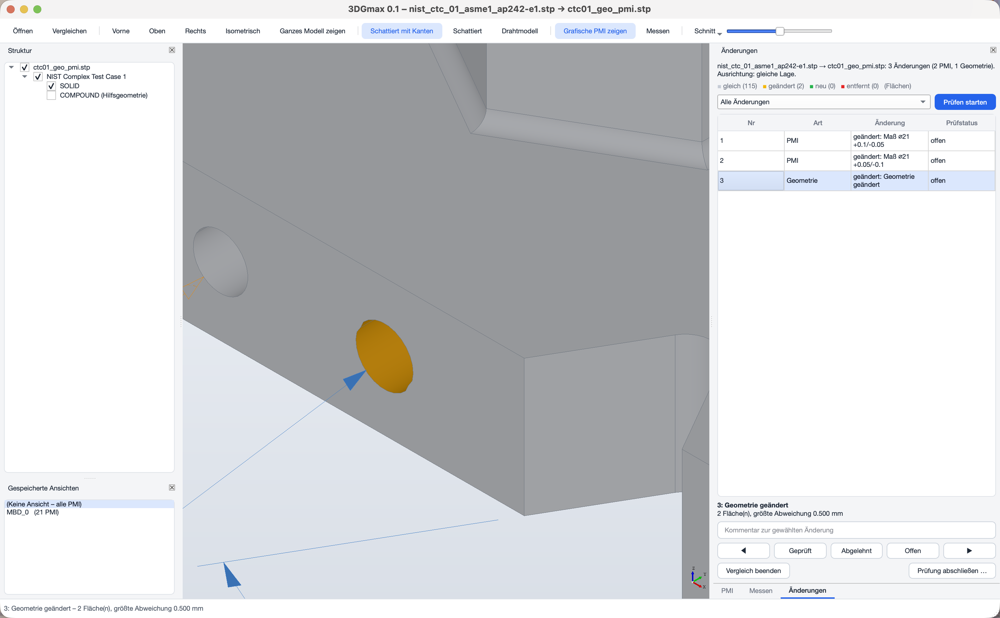

# 3DGmax

View, measure and compare 3D models with PMI (dimensions, geometric tolerances, datums) from STEP AP242 – for
Model Based Definition without 2D drawings. 3DGmax reads PMI **semantically** (as evaluable values, not just as a
picture) and compares two revisions of a model in geometry **and** PMI, with a guided review and a review report.



## Features
**Formats** – STEP AP242/AP214/AP203 with semantic and graphical PMI and saved views, QIF 3.0 (exact B-rep and
semantic PMI), IGES, and meshes STL, OBJ, glTF/GLB, 3MF; ASME Y14.5 or ISO GPS detected from the file (default ISO GPS).

**Viewing** – CATIA-style navigation (classic optional), view cube, view back/forward, perspective, section planes and
section box, exploded view, display modes, light/dark theme, thumbnails of saved views, own views.

**PMI** – list with targeted search (`datum:A`, `value:0.5`, `type:position`), ISO GPS columns (limits, deviations,
ISO 286 fits), datum reference frame display, tolerance zones, balloons and bill of characteristics, plausibility
check, graphical PMI generated where a file has only semantics, PMI creation with a tolerancing advisor.

**Measuring and analysis** – quick measure in the status bar, distance/angle/radius/wall thickness with snapping,
model properties (volume, mass, center of gravity), parts list, draft angle, curvature and wall thickness maps,
1D tolerance stack-up (worst case, RSS, Monte Carlo), comments on faces and PMI.

**Comparison** – automatic or manual alignment, geometry status per face, deviation color map, added/removed material,
moved elements and PMI, assembly changes, semantic and graphical PMI diff, review walk-through with a SHA-256 report.

**Output** – PDF reports (views, comparison, PMI changes, bill of characteristics, measurements, comments), drawings
via hidden-line removal as PDF/SVG/DXF with PMI, CSV exports, project container (`.3dgmax`), folder comparison.

User interface in German and English.

Status and plans: [docs/Roadmap.md](docs/Roadmap.md) · [PLAN.md](PLAN.md)

## Run from source
Requires [pixi](https://pixi.sh).
```bash
pixi install
pixi run start          # application
pixi run test           # tests (offscreen)
```

## Build portable apps
`packaging/build_mac.sh`, `packaging/build_linux.sh`, `packaging\build_windows.bat` (each accepts `--ohne-tests`
to skip tests), or on GitHub: *Actions › Apps bauen*.

## License
© 2026 Max Wilfinger. GNU General Public License v3 or later (GPL-3.0-or-later), see [LICENSE](LICENSE).
Libraries used (Open CASCADE Technology, pythonocc-core, Qt/PySide6 under LGPL and others) are listed in
*Help › About 3DGmax*. Test models: NIST MBE PMI Validation and Conformance Testing (public domain).
