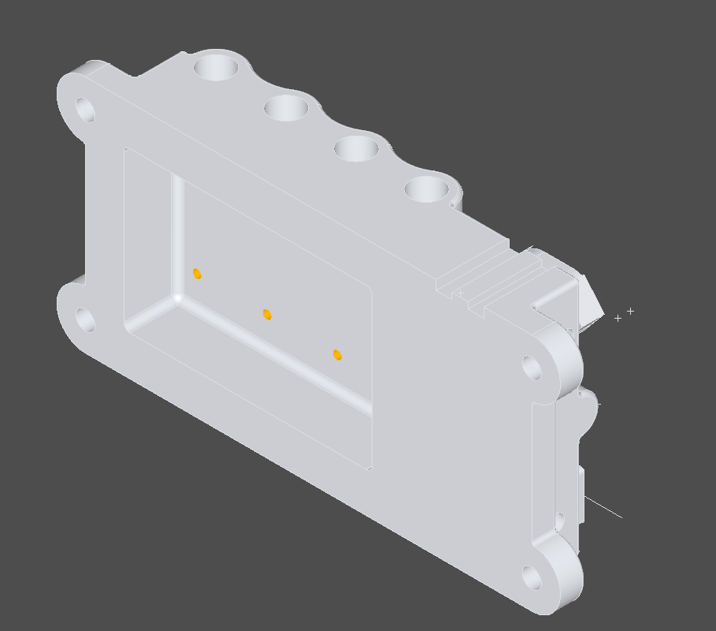

# Feasibility (step 1) – results

Checked on the 17 public NIST AP242 models (CTC 1–5, FTC 6–11, STC 6–10). Numbers per file:
[Feasibility_Table.md](Feasibility_Table.md) (regenerate with `pixi run machbarkeit`).

## Summary

| Question | Result |
|---|---|
| Load STEP AP242 (geometry) | ✅ all 17 files, 0.1–1.5 s each, including tessellated geometry (FTC-08-tg) |
| Number faces uniquely, STEP #ID ↔ face | ✅ 100 % of faces mapped |
| Dimensions (type, nominal, deviations, limits, fit, basic/reference) | ✅ 266/266, 98 % with value (the rest has no value in the file), 93 % with faces |
| Geometric tolerances (symbol, value, ⌀ zone, Ⓜ/Ⓛ, Ⓟ, datum reference frame, datum groups) | ✅ 362/362, 100 % with value, 98 % with faces |
| Datums A, B, C … with faces | ✅ 114/114, 91 % with faces (rest: datum targets as point/line) |
| Saved views with camera and associated PMI | ✅ all views, PMI per view via the STEP links |
| Click PMI → highlight faces, click face → PMI | ✅ |
| OCCT viewer in PySide6 | ✅ (OpenGL, Retina) |
| JT | ❌ no free reader in OCCT/pythonocc; see below |
| 3D PDF | ⏳ checker script ready, sample files missing (NIST PDFs are 2D drawings) |
| IGES, STL, OBJ, glTF/GLB | ✅ readers present in pythonocc (not yet connected) |
| 3MF | small own reader needed (ZIP + XML) |

## Key findings

1. **Geometry kernel: pythonocc-core instead of OCP** (changed from the plan, based on experiments).
   - In OCP 8.0.1 all OCCT map lookups fail from Python (`Model.Contains(Model.Value(25))` returns False) and the
     `TransferBRep` package is missing, so STEP #IDs cannot be mapped to faces.
   - pythonocc-core 8.0.1.2 (conda-forge via **pixi**) does both: 117/117 faces of CTC-01 mapped.
2. **3DGmax reads semantic PMI itself from the STEP file**, OCCT is used for cross-checking only. Reasons:
   - pythonocc does not wrap `XCAFDoc_GeomTolerance` → tolerance frames not readable via OCCT.
   - OCCT loses face links when the file uses `SET_REPRESENTATION_ITEM` (CTC-01: datums B and C).
   - OCCT misses dimensions (STC-07: 7, FTC-08: 4, FTC-10: 3), drops fits (FTC-10: ⌀3.5 G6) and reads one limit
     dimension of FTC-07 (inch) wrongly (nominal instead of minimum 0.012 in).
   - Own reader contains every dimension OCCT reads (test `test_eigene_masse_umfassen_occt`).
   - Every PMI keeps its STEP #ID → reliable mapping to views, graphics and comparison.
3. **Graphical PMI** (annotation lines/text) is present in all NIST files and is displayed from the file.

## Formats

**JT (ISO 14306):** OCCT has no free JT reader. Options:
| Approach | Content | Cost | Effort |
|---|---|---|---|
| Own reader (mesh) | tessellation, assembly, no PMI | 0 | large (weeks, JT 8–10 differ) |
| TKJT (as used by FreeCAD) | mesh, structure; PMI part present | 0, GPL v2+ | medium–large |
| Siemens JT Open Toolkit | everything incl. PMI | membership, price on request | medium (C++ binding) |
| Open Cascade JT SDK | mesh, LOD, structure | quote | small |
| CAD Exchanger SDK / HOOPS Exchange | everything incl. PMI | quote | medium |

**3D PDF:** `werkzeuge/pdf3d_pruefen.py` finds 3D annotations and extracts U3D/PRC. An own U3D mesh reader
(ECMA-363) is feasible (medium). No usable free PRC (ISO 14739) reader was found. Sample 3D PDFs are needed.

**QIF:** step 6, public schema (qifstandards.org), XML via lxml.
